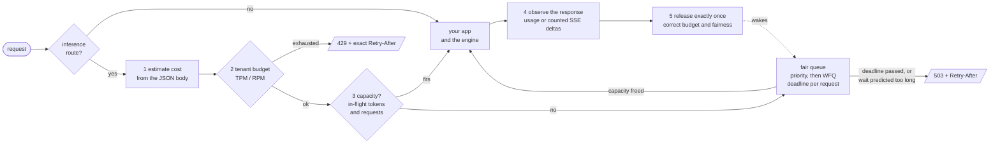

# admitq

**Token-aware admission control for self-hosted LLM endpoints: an ASGI middleware that
prices each request in tokens, bounds how long it may queue, shares capacity fairly
between tenants, and sheds the rest with an honest `Retry-After`.**

[](https://github.com/cb-Sigma/admitq/actions/workflows/ci.yml)
[](LICENSE)
[](pyproject.toml)

```python
from fastapi import FastAPI
from admitq import InferenceAdmission

app = FastAPI()
app.add_middleware(
    InferenceAdmission,
    max_inflight_tokens=64_000,        # estimated tokens in flight, not requests
    max_queue_s=2.0,                   # nobody waits longer than this for capacity
    tenant_tpm={"default": 200_000},   # per-tenant tokens/minute, corrected with real usage
)

@app.post("/v1/chat/completions")      # your existing proxy to vLLM / llama.cpp / SGLang / TGI / Ollama
async def chat(...): ...
```

That is the whole integration.  Requests to `/v1/chat/completions`, `/v1/completions`,
`/v1/embeddings` and `/v1/responses` are now admitted, queued or shed; everything else
passes through untouched.

```bash
pip install git+https://github.com/cb-Sigma/admitq
```

Python 3.10+.  **No dependencies.**  Works with FastAPI, Starlette, Litestar or any other
ASGI app, and without ASGI through [`AdmissionController`](#without-asgi).
Not on PyPI yet.

---

## The problem

You run a model server and put your own FastAPI layer in front of it for auth and request
shaping.  It works, until the day traffic exceeds what the engine can generate:

- The engine queues what it cannot run.  By default vLLM's waiting queue is unbounded
  ([vllm#18826](https://github.com/vllm-project/vllm/issues/18826)), and so is llama.cpp's
  deferred-task queue.  Where engines do offer a bound it is a global count: recent vLLM
  has opt-in `--max-num-queued-reqs`, SGLang `--max-queued-requests`, TGI and Ollama a
  maximum number of pending requests ([sources](docs/engines.md)).  None of them knows
  your tenants, or how long a request has been waiting.
- Every request gets slow, including the ones from users who did nothing unusual.
- Clients time out and retry.  The engine keeps generating for clients that have left.
- Nothing tells a client to back off, and nothing protects one tenant from another.

The usual first fix is a rate limiter such as slowapi or fastapi-limiter.  They count
**requests**.  An inference server's capacity is **tokens**: a 50 000-token prompt and a
"hi" are one request each.

### Why counting requests is not enough

A simulated engine (16 concurrent sequences, 800 tokens/s) serves three tenants for five
minutes.  `alice` and `bob` send short interactive requests that need 30% of the engine
between them.  `noisy` sends long prompts asking for almost twice what the engine can
produce.  "Good" means completed within 10 seconds; clients give up after 30.

| | alice: good requests | alice: p99 latency | alice: wrongly refused | noisy: served | waiting inside engine (peak) |
|---|---:|---:|---:|---:|---:|
| no admission control | 3% | 30.0 s | - | 5% | 272 |
| request limit, 200/min per tenant | 3% | 30.0 s | 0% | 5% | 194 |
| request limit, 60/min per tenant | 71% | 5.0 s | **29%** | 21% | 15 |
| **admitq** | **95%** | 4.4 s | 5% | 27% | 0 |
| **admitq** + `max_tenant_share=0.5` | **99.5%** | 3.7 s | 0.5% | 21% | 0 |

<sub>**SIMULATED** - a fake engine on a virtual clock, seed 0; the request limiter is
emulated by admitq configured with only `tenant_rpm`.  Reproduce with
`python benchmarks/simulated_overload.py`; full tables, the spread over seeds and the
caveats are in [docs/experiments.md](docs/experiments.md).</sub>

A request limit generous enough for normal use (200/min) rejects a third of the noisy
tenant's requests and changes nothing: each one it lets through weighs as much as several
of alice's.  Tightened until it works (60/min), it also throws away 29% of alice's
perfectly ordinary traffic - a count cannot tell an 80-token request from an 1800-token
one, so no setting is right for both.  admitq prices each request, keeps the engine's own
queue empty, and refuses the excess in milliseconds instead of after a 30-second timeout.

On a real (tiny, CPU) llama.cpp server the same thing happens:
[goodput went from 0.06 to 0.58 requests/s](#experiments) under 4x overload.

## How it works



1. **Estimate.**  The body is buffered (up to a cap), parsed once and priced: prompt
   tokens from `messages` / `prompt` / `input` / `tools`, plus the output the request may
   generate (`max_tokens` x `n`).  The default estimator is a character heuristic with no
   dependencies; real tokenizers plug in.
2. **Budget.**  Per-tenant token-per-minute and request-per-minute token buckets.  A
   refusal is a 429 whose `Retry-After` is exact.
3. **Admit, queue or shed.**  Capacity is counted in *in-flight tokens* as well as
   requests.  A request that does not fit waits in a queue bounded by **time**: its
   deadline is `max_queue_s` or the client's own timeout header, whichever is shorter.
   If the measured drain rate says it cannot make that deadline it is refused on arrival
   rather than after waiting.  Who goes next: priority class first (with ageing, so batch
   work is not starved), then weighted fair queuing between tenants, then arrival order.
4. **Observe.**  The response streams through unmodified while admitq reads `usage` from
   the JSON body or the final SSE chunk - or counts the streamed deltas if the engine
   reports none.
5. **Settle.**  Capacity is released exactly once - on completion, error, cancellation or
   client disconnect - and the tenant's budget and fairness account are corrected by
   `actual - estimate`.  Over-estimates are refunded; under-estimates become bounded debt.

A response that has started is never shed.  The details, including what is charged when
a stream is cut short, are in [docs/how-it-works.md](docs/how-it-works.md).

### What a refusal looks like

```http
HTTP/1.1 429 Too Many Requests
retry-after: 3
x-admitq-shed-reason: tenant_tokens
x-ratelimit-limit-tokens: 200000
x-ratelimit-remaining-tokens: 0
content-type: application/json

{"error": {"message": "Token-per-minute budget exceeded for this tenant.",
           "type": "rate_limit_error", "param": null, "code": "rate_limit_exceeded",
           "reason": "tenant_tokens", "retry_after": 2.5}}
```

Overload answers `503` with `code: "server_overloaded"` and a reason of `queue_timeout`,
`predicted_wait` or `queue_full`.  The OpenAI Python SDK retries both statuses and honours
`Retry-After`.  Admitted responses carry `x-admitq-queue-ms`,
`x-admitq-estimated-tokens` and the `x-ratelimit-*` pair.

## More than the one-liner

```python
from admitq import InferenceAdmission, PriorityClass, TiktokenEstimator, header_tenant

app.add_middleware(
    InferenceAdmission,
    # capacity
    max_inflight_requests=32,  # vLLM --max-num-seqs, llama.cpp --parallel
    max_inflight_tokens=64_000,
    max_tenant_share=0.5,  # no tenant holds more than half of it
    # queue
    max_queue_s=2.0,
    # tenants
    tenant_key=header_tenant("x-tenant-id"),  # default: a hash of the API key
    tenant_tpm={"default": 200_000, "acme": 1_000_000},
    tenant_rpm={"default": 600},
    tenant_weights={"acme": 4},
    # priorities: `x-priority: batch` waits longer and yields to interactive traffic
    priorities=[PriorityClass("interactive", 0), PriorityClass("batch", 1, max_queue_s=30)],
    # estimation
    estimator=TiktokenEstimator("cl100k_base"),  # pip install "admitq[tiktoken] @ git+..."
    # lifecycle and observability
    cancel_on_disconnect=True,
    metrics_path="/admitq/metrics",
)
```

Complete, runnable programs are in [`examples/`](examples):

| Example | Shows |
|---|---|
| [`fastapi_proxy.py`](examples/fastapi_proxy.py) | a streaming proxy in front of vLLM / llama.cpp, with everything switched on |
| [`litestar_app.py`](examples/litestar_app.py) | Litestar, a shared controller and a `/stats` route |
| [`programmatic_httpx.py`](examples/programmatic_httpx.py) | no ASGI: a worker calling the engine with httpx |
| [`redis_budgets.py`](examples/redis_budgets.py) | budgets shared across `uvicorn --workers 4` |
| [`adaptive_limit.py`](examples/adaptive_limit.py) | a limit that follows vLLM's queue-depth gauge |
| [`tune_in_tests.py`](examples/tune_in_tests.py) | choosing settings with simulated load in pytest |

### Without ASGI

```python
from admitq import AdmissionController, Shed

controller = AdmissionController(
    max_inflight_tokens=16_000, max_queue_s=30.0, tenant_tpm={"default": 120_000}
)


async def complete(client, tenant, body):
    try:
        async with controller.admit(tenant=tenant, cost=controller.estimate(body)) as ticket:
            response = await client.post("/v1/chat/completions", json=body)
            ticket.report_usage(**response.json()["usage"])  # correct the estimate
            return response
    except Shed as shed:
        print(shed.reason, shed.status, shed.retry_after)
```

Capacity comes back when the `async with` block exits, however it exits.

### An in-flight limit that finds itself

A static limit is a guess about your engine.  `AdaptiveLimit` replaces it with an AIMD
loop on a congestion signal: the time to first byte admitq measures anyway, or a gauge
you poll from the engine (`vllm:num_requests_waiting`, `llamacpp:requests_deferred`, ...).

```python
from admitq import AdaptiveLimit

app.add_middleware(
    InferenceAdmission,
    max_inflight_tokens=64_000,  # starting point
    adaptive=AdaptiveLimit(target=0.5, min_limit=4_000, max_limit=400_000),
)
```

In simulation, against an engine that fits 8 requests, it settles into the band 7-9 from
starting points of 1 and 64.  It has **not** been validated on a GPU engine; see
[the caveats](docs/how-it-works.md#the-adaptive-limit-optional).

### Tune it in a unit test

```python
from admitq.testing import FakeModelBackend, TenantLoad, run_virtual, simulate_load


def test_chat_survives_the_nightly_eval():
    app = InferenceAdmission(FakeModelBackend(max_num_seqs=8, total_tps=240), **settings)
    report = run_virtual(
        simulate_load(
            app,
            [
                TenantLoad("chat-ui", rps=1.0, max_tokens=60),
                TenantLoad("nightly-eval", rps=6.0, prompt_tokens=600, max_tokens=120),
            ],
            duration_s=300,
            slo_s=8.0,
        )
    )
    assert report.tenant("chat-ui").goodput_fraction > 0.97
```

`run_virtual` runs asyncio on a virtual clock: five minutes of overload takes a couple of
seconds and gives the same answer every time.  More in [docs/testing.md](docs/testing.md).

## Configuration reference

The options you will actually touch.  Everything, with defaults and advice on choosing
numbers, is in [docs/configuration.md](docs/configuration.md).

| Option | Default | Meaning |
|---|---|---|
| `max_inflight_tokens` | `None` | Estimated tokens (prompt + reserved output) in flight at once |
| `max_inflight_requests` | `None` | Requests in flight at once |
| `max_tenant_share` | `None` | Largest fraction of in-flight tokens one tenant may hold |
| `max_queue_s` | `2.0` | Longest wait for capacity; per priority class if you want |
| `max_queue_depth` | `1024` | Most requests waiting at once |
| `early_shed` | `True` | Refuse on arrival when the predicted wait exceeds the deadline |
| `tenant_tpm` / `tenant_rpm` | `None` | Budgets: `{"default": n, "tenant": m}` or a number |
| `tenant_weights` | `{}` | Fair-queuing weights |
| `burst_s` | `60.0` | Bucket size, in seconds of refill |
| `priorities` | interactive, batch | `{name: level}` or `PriorityClass` objects (own deadline, ageing) |
| `tenant_key` / `priority_key` | API-key hash / `x-priority` | Functions of the request |
| `estimator` | `CharEstimator()` | `TiktokenEstimator`, `TokenizersEstimator`, or your own |
| `backend` | in-memory | `RedisBackend` to share budgets across workers |
| `adaptive` | `None` | `AdaptiveLimit(...)` |
| `routes` | OpenAI paths | Which paths are inference requests, and of what kind |
| `max_body_bytes` | 4 MiB | Larger bodies stream through and are priced by size |
| `cancel_on_disconnect` | `False` | Cancel the app when the client goes away |
| `inject_stream_usage` | `False` | Ask the engine for exact usage on streams |
| `overload_status` | `503` | Or `429` |
| `metrics_path` | `None` | Serve Prometheus text here |

## Backends, and what is consistent across workers

| State | Where | Across workers / replicas |
|---|---|---|
| In-flight limits, the queue, fairness clocks | process memory | **per process, always** |
| Tenant TPM / RPM budgets | budget backend | in-memory: per process · **Redis: shared, atomic** |
| Metrics | process memory | per process (aggregate in Prometheus) |

With the default in-memory backend, four workers mean four independent sets of budgets: a
tenant can spend up to four times its TPM.  `RedisBackend` fixes that - one Lua script per
request refills, checks and debits both buckets atomically, on the Redis server's clock:

```python
from admitq.backends.redis import (
    RedisBackend,
)  # pip install "admitq[redis] @ git+https://github.com/cb-Sigma/admitq"

app.add_middleware(
    InferenceAdmission,
    backend=RedisBackend.from_url("redis://redis:6379/0"),
    on_backend_error="open",  # Redis down: skip budgets, in-flight limits still hold
    tenant_tpm={"default": 200_000},
    max_inflight_tokens=64_000 // WORKERS,
)  # in-flight limits stay per process: divide
```

The in-flight limits and the queue are per process with either backend.  A typical asyncio
proxy is one process, where this does not matter; with several, give each its share.
[docs/backends.md](docs/backends.md) has the details and the failure modes.

## Metrics

Zero-dependency Prometheus text at `metrics_path` (or `metrics_app(controller)` to mount
yourself), plus optional `prometheus_client` and OpenTelemetry recorders.

| Metric | Labels |
|---|---|
| `admitq_admitted_total`, `admitq_queued_total` | `tenant`, `priority` |
| `admitq_shed_total` | `tenant`, `priority`, `reason` |
| `admitq_completed_total` | `tenant`, `outcome` |
| `admitq_queue_time_seconds`, `admitq_time_to_first_byte_seconds` (histograms) | `priority` / - |
| `admitq_estimate_ratio` (histogram of actual / estimated) | `source` |
| `admitq_estimated_tokens_total`, `admitq_actual_tokens_total` | `tenant` (, `source`) |
| `admitq_inflight_tokens`, `admitq_inflight_requests`, `admitq_queue_depth`, `admitq_queued_tokens`, `admitq_inflight_token_limit`, `admitq_inflight_request_limit` (gauges) | - |
| `admitq_backend_errors_total` | `operation` |

Tenant labels are capped (`max_tenant_labels=100`, the rest become `_other`), so an
unbounded set of API keys cannot blow up your metrics.  What to graph and alert on:
[docs/metrics.md](docs/metrics.md).

## When to use a gateway instead

admitq is a library inside one service.  If what you need is a service in front of many,
use one - these are good, and they do things admitq never will:

- **[LiteLLM proxy](https://docs.litellm.ai/docs/simple_proxy)** when you front many
  providers or models and need virtual keys, spend tracking, budgets and fallbacks.
- **[Envoy AI Gateway](https://github.com/envoyproxy/ai-gateway)** (now presented as
  *Agent Router*) when traffic policy belongs to a platform team and should be enforced
  at the proxy, on Kubernetes, for every service at once.
- **[llm-d](https://llm-d.ai)** when you run fleets of model servers and want
  cache- and load-aware routing across replicas with priority- and fairness-aware flow
  control.  It sees every replica; admitq sees one process.
- **[api7/aisix](https://github.com/api7/aisix)** for an open-source gateway with
  RPM/TPM limits and concurrency caps per key, model and team.

Choose a gateway if you have several applications in front of the models, more than a
couple of replicas to route between, or requirements around keys, spend and audit.
Choose admitq if there is one Python service in front of one engine or a few and the
missing piece is between "request arrived" and "engine is busy".  They also stack: the
gateway in front for keys and routing, admitq next to each engine as the last,
token-aware line of defence.  A fuller comparison, including the rate limiters, is in
[docs/related-work.md](docs/related-work.md).

## Experiments

**Simulated** (deterministic; fake engine, virtual time) - the table at the top.  Overall
goodput in that run: 0.14 good requests/s without control, 3.70 with admitq, from an
engine producing about the same number of tokens in both cases (614 vs 623 tokens/s).
Without admission control most of those tokens went to clients that had already timed out.

**Real engine, small:** SmolLM2-135M-Instruct (4-bit GGUF) served by `llama-cpp-python`'s
server on 3 CPU threads, behind [`examples/fastapi_proxy.py`](examples/fastapi_proxy.py),
with open-loop traffic at about 4x what the engine could generate, for 90 s per arm.

| | completed | shed (fast) | timed out at 30 s | p50 latency | p99 latency | good requests/s |
|---|---:|---:|---:|---:|---:|---:|
| no admission control (seed 0) | 21 / 142 | 0 | 121 | 28.5 s | 30.0 s | 0.06 |
| **admitq** (seed 0) | 58 / 142 | 84 | **0** | 4.6 s | 11.1 s | **0.58** |
| no admission control (seed 1) | 28 / 124 | 0 | 96 | 28.5 s | 30.0 s | 0.07 |
| **admitq** (seed 1) | 55 / 124 | 69 | **0** | 4.9 s | 11.4 s | **0.57** |

The two quiet tenants completed 82 of 88 requests with admitq (13 of 47 and 19 of 41
without).  To be plain about what this is: one tiny model on a 4-core VM that was busy
with other jobs at the time (the model ran at only 20-24 tokens/s), one generation at a
time, two short runs with small counts.  **GPU engines with continuous batching were not
tested.**  Method, per-tenant tables and caveats: [docs/experiments.md](docs/experiments.md).

**Overhead:** about 0.1 ms per request and 7 microseconds per streamed chunk on that same
busy VM (Python 3.12, in-process, `python benchmarks/overhead.py`).

## Limitations

- **Estimates are estimates.**  The default heuristic is four characters per token.  It
  under-counts dense scripts and code, knows nothing about your chat template, and prices
  images at a flat rate.  Reservations are worst-case (`max_tokens`), so clients that set
  it high and use little make the token limit tighter than it looks until the response
  ends.  Correction fixes budgets after the fact; it cannot fix capacity that was held in
  the meantime.  Watch `admitq_estimate_ratio`.
- **In-memory state is per process.**  In-flight limits and the queue always; budgets
  unless you use Redis.  There is no distributed queue.
- **It cannot see inside the engine.**  No knowledge of batching, KV-cache pressure or
  prefix-cache hits; "in-flight tokens" is a proxy for load.  It cannot preempt or reorder
  admitted work, so on an engine that runs one request at a time a short request still
  waits behind a long one.
- **`Retry-After` on overload is a forecast** from the measured drain rate, not a
  reservation.  (On budget refusals it is exact.)
- **Usage is only as good as what the engine reports.**  Without a usage chunk, streamed
  output is counted from deltas and the prompt keeps its estimate.  Compressed responses
  are not inspected.
- **Disconnect handling depends on your app.**  Capacity is released when your app
  returns.  If it keeps running after the client has gone, use `cancel_on_disconnect`.
- **Tenant identity is whatever your key function says.**  admitq does not authenticate.
  See [SECURITY.md](SECURITY.md).
- **Young code.**  It is tested hard (below), but version 0.1 has not yet carried
  production traffic.

### How it is tested

309 tests, run on Python 3.10-3.13.  The scheduler, budgets, fairness and priorities are
tested deterministically against explicit timestamps; Hypothesis checks the invariants
(capacity never exceeded, every admission released exactly once, queue time within its
bound, the fair-queuing bound, no starvation under ageing) over arbitrary operation
sequences; the middleware is driven end to end on a virtual clock, through httpx's ASGI
transport inside FastAPI, Starlette and Litestar, and over real sockets on uvicorn -
including clients that disconnect mid-stream, abrupt TCP resets, body replay, bodies
larger than the buffer, non-JSON bodies, and randomised concurrency storms.  The Redis
backend is tested against a real `redis-server`.

## Related work

- The need, upstream: [vllm#18826](https://github.com/vllm-project/vllm/issues/18826)
  (RFC: bound the waiting queue), [vllm#2901](https://github.com/vllm-project/vllm/issues/2901)
  (max queue time), [vllm#41250](https://github.com/vllm-project/vllm/issues/41250)
  (an overloaded response), [vllm#49538](https://github.com/vllm-project/vllm/issues/49538)
  (queue gauges lag reality).  Engines' own count-based valves: vLLM
  `--max-num-queued-reqs` / `--max-num-queued-tokens` (recent versions, off by default),
  SGLang `--max-queued-requests`, TGI `--max-concurrent-requests`, Ollama
  `OLLAMA_MAX_QUEUE`.  Use them as well: they are the backstop behind admitq.
- Request-rate limiters for ASGI: [slowapi](https://github.com/laurentS/slowapi),
  [fastapi-limiter](https://github.com/long2ice/fastapi-limiter),
  [asgi-ratelimit](https://github.com/abersheeran/asgi-ratelimit).  Good for what they
  are for, and they compose with admitq.
- Closest in spirit: [tokenguard](https://github.com/mangobanaani/tokenguard)
  (hierarchical token buckets with usage adjustment, for proxying OpenAI) and
  [sptc-gate](https://github.com/rockswe/sptc-gate) (a best-effort request class inside
  vLLM's scheduler).
- Ideas borrowed: start-time fair queuing (Goyal, Vin and Cheng, 1996), the token bucket,
  AIMD congestion control (Chiu and Jain, 1989), and the argument for shedding early and
  bounding queues by time from the overload-control literature.

More, with descriptions and caveats: [docs/related-work.md](docs/related-work.md).

admitq is an independent project.  It is not affiliated with, endorsed by or sponsored by
vLLM, llama.cpp, SGLang, Hugging Face TGI, Ollama, FastAPI, Starlette, Litestar, LiteLLM,
Envoy, llm-d, OpenAI or any other project or company named here; their names are used
only to describe compatibility.

## FAQ

**Does it work with streaming?**  Yes; that is most of the point.  Capacity is held for
the life of the stream and released when it ends, however it ends.  The stream itself is
not buffered, re-framed or delayed.

**What does it do to my non-inference routes?**  Nothing.  They receive the original
`scope`, `receive` and `send`.

**I do not use the OpenAI API shape.**  Set `routes` to your paths; the estimator also
reads `prompt`, `input`, `n_predict` and `options.num_predict`, and the response observer
understands Ollama's and llama.cpp's native usage fields.  For anything else, pass your
own estimator - it is one method.

**503 or 429?**  Budget refusals are 429 (the client did it).  Overload is 503 by default
(the server is busy); set `overload_status=429` if your clients only back off on 429.

**Why is a request shed immediately instead of queued?**  Because the measured drain rate
says it would not reach the front before its deadline.  Failing in a millisecond with a
`Retry-After` beats failing after `max_queue_s`.  `early_shed=False` turns this off.

**How do I pick `max_inflight_tokens`?**  Start from the engine's concurrency setting
times a typical request, then watch time to first byte (rising: limit too high) and
`admitq_estimate_ratio` (far below 1: reservations much larger than usage).  Or simulate
it first with `admitq.testing`, or let `AdaptiveLimit` find it.

**Can clients choose their own priority?**  With the default `x-priority` header, yes -
treat it as a hint between cooperating callers.  To enforce it, derive priority from the
authenticated identity in a `priority_key` function.

**Multiple workers?**  Budgets: use `RedisBackend`.  In-flight limits: per process, divide
by the worker count.  See [backends](#backends-and-what-is-consistent-across-workers).

**Is the body read twice?**  It is read once by admitq and replayed to your app from
memory.  Bodies over `max_body_bytes` are not buffered at all.

**Does it retry or route between replicas?**  No.  It decides whether *this* process
should take *this* request now.  Routing is a gateway's job.

## Roadmap

- A shared in-flight limit and queue across processes (Redis leases with expiry).
- Validation of the adaptive limit against real GPU engines; a gradient-based variant.
- Learned output estimates (observed completion length per route and tenant) instead of
  reserving `max_tokens`.
- Prefix-cache-aware pricing for engines that report cached tokens.
- Stripping the extra usage chunk when `inject_stream_usage` is on.
- Tokenization off the event loop for very large prompts.
- A PyPI release.

Not planned: provider routing, key management, spend tracking, a UI.  Those are gateways.

## Contributing

Issues and pull requests are welcome; see [CONTRIBUTING.md](CONTRIBUTING.md).

```bash
pip install -e ".[dev]"
ruff check . && ruff format --check . && mypy && pytest
```

## License

[Apache-2.0](LICENSE).  Copyright 2026 The admitq Authors.
